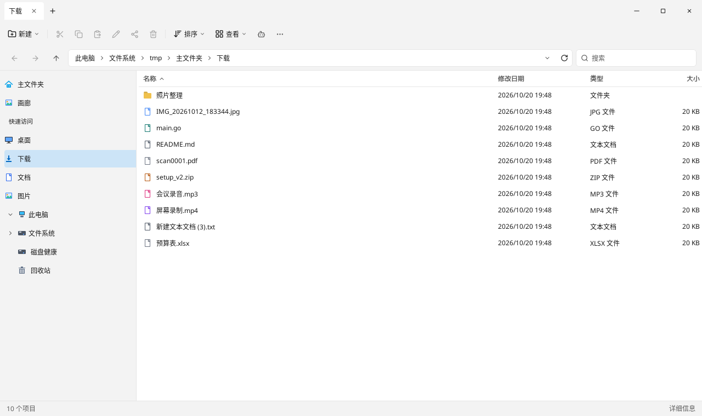
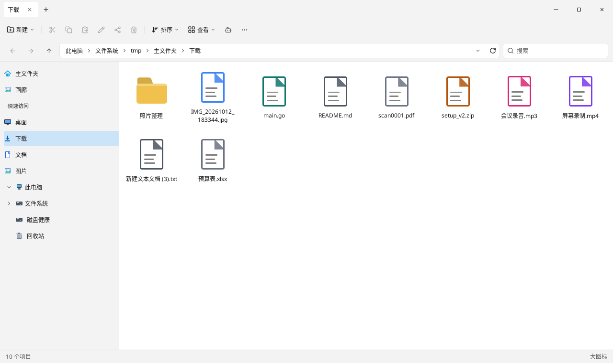
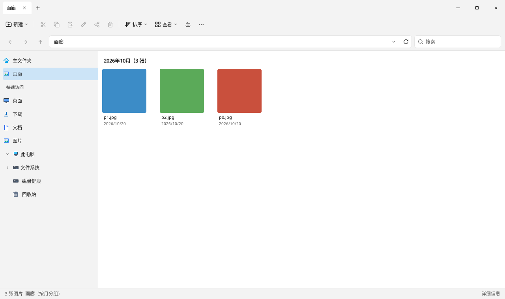
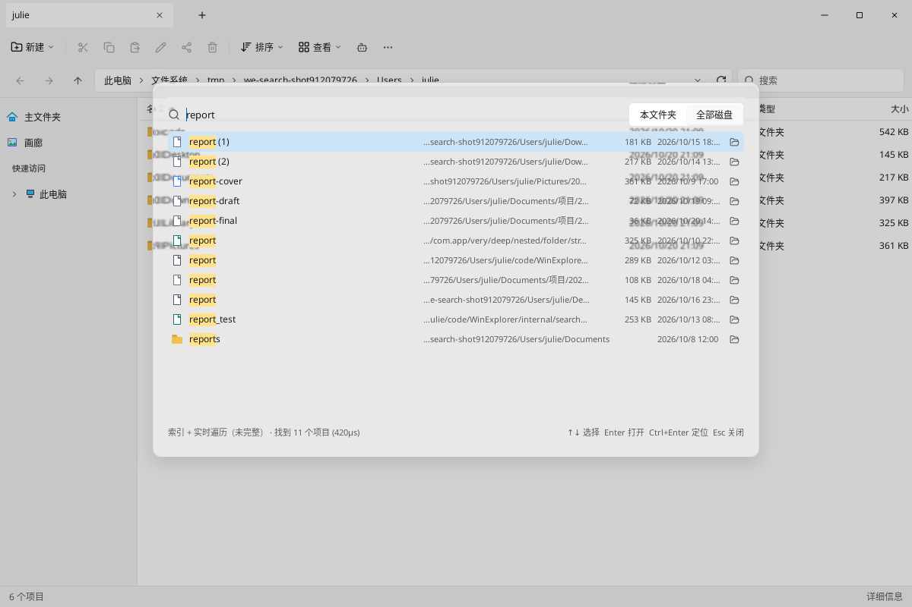
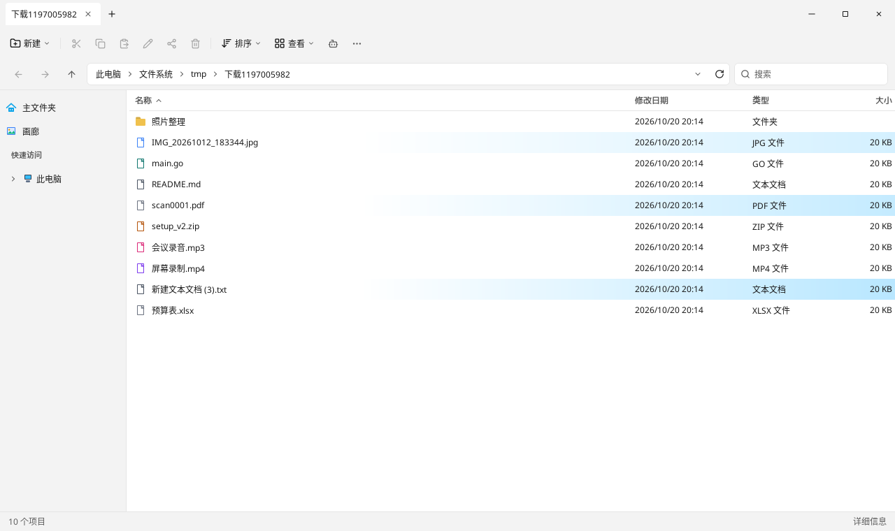
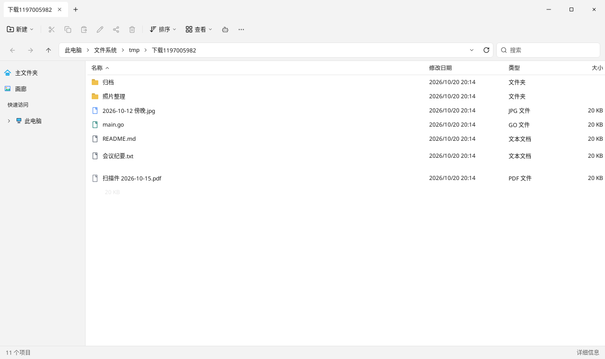
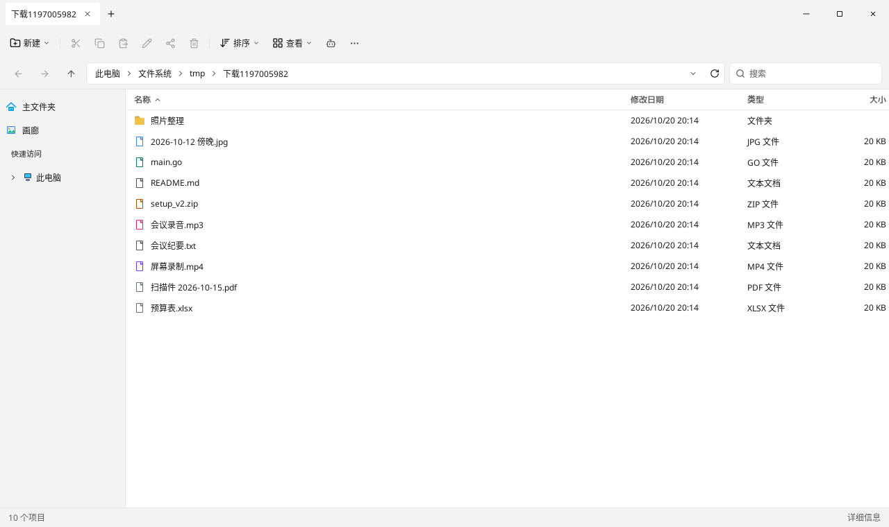
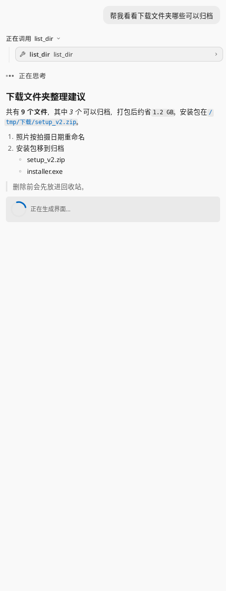
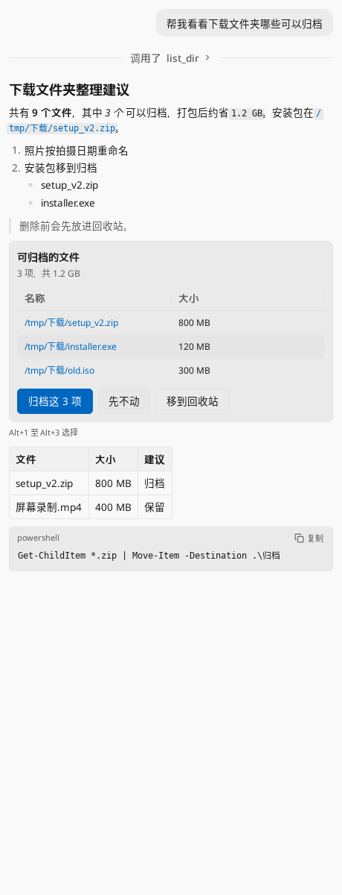
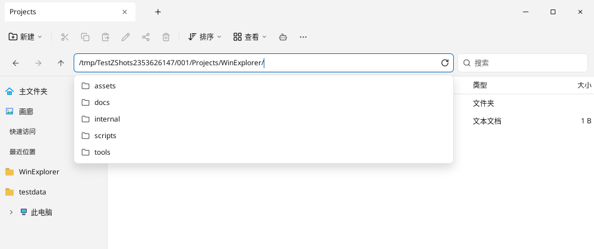

# 晴谷（Sunvale）界面与动效规范

本文是界面的**现行规范**，所有数值均对照 `origin/main` 74ead83 的代码核实（`文件:函数/常量`）。代码与本文不一致时：若代码是有意的改动，同一提交更新本文；否则以本文为准修代码。标注“规划中”的条目尚未实现，规格见 `docs/specs/`。

截图（离屏渲染，均为浅色主题）位于 `docs/assets/ui/`。

## 1. 设计令牌

### 1.1 颜色（`theme.go:resolveTokens`）

只通过 `colorXxx()` 访问函数取色，不写死色值。外观切换后 `theme.go:repaintAppearance` 会重新解析令牌并重绘所有窗口。

| 令牌 | 访问函数 | 浅色 | 深色 | 用途 |
| --- | --- | --- | --- | --- |
| tokWindow | `colorWindow()` | #F3F3F3 | #202020 | 窗口底色；标题栏、侧栏、状态栏同值（`tokChrome/tokNav/tokStatus`） |
| tokContent | `colorContent()` | #FFFFFF | #272727 | 文件列表底色 |
| tokSel | `colorSelected()` | #CCE4F7 | #004C87 | 选中行/磁贴 |
| tokHover | `colorHover()` | rgba(0,0,0,.06) | rgba(255,255,255,.06) | 悬停底色 |
| tokText | `colorText()` | #1A1A1A | #F3F3F3 | 主文字 |
| tokMuted | `colorMuted()` | #5C5C5C | #A0A0A0 | 次要文字、图标 |
| tokAccent | `colorAccent()` | #0067C0 | #4CC2FF | 主操作、焦点、链接 |
| tokDivider | `colorDivider()` | #E5E5E5 | #383838 | 分隔线、次要边框 |
| tokFolder | `colorFolder()` | #F0C14D | #E8B84A | 文件夹图标 |
| tokAddress | `colorAddress()` | #FFFFFF | #2D2D2D | 地址栏、浮层表面 |
| tokBtnText | `colorBtnText()` | #FFFFFF | #1A1A1A | 主按钮文字 |
| tokFieldBorder | `colorFieldBorder()` | #D6D6D6 | #383838 | 输入框边框 |
| tokHit | `colorHit()` | #FFE28A | #8A6D00 | 搜索命中高亮 |
| tokSurface | （无访问函数，经 `appTheme` 作 `Background`） | #F9F9F9 | #2C2C2C | 应用自身弹层底色 |
| tokDanger | 经 `c.Theme().Danger` | #C42B1C | #FF5C5C | 危险操作、错误 |
| tokWarning | 经 `c.Theme().Warning` | #C77700 | #FFC83D | 警告 |
| tokSuccess | 经 `c.Theme().Success` | #0F7B0F | #6CCB5F | 正常/成功 |
| — | `colorCloseHover()` | #C42B1C | #C42B1C | 窗口关闭按钮悬停 |
| — | `addressbar.go:colorPressed()` | 文字色 α0.1 | 同左 | 按下态 |

mygo/Onevra 组件主题（`theme.go:appTheme`）：`SurfaceHover = tokAddress.Mix(tokText, .06)`，`SurfacePressed = …0.12`，`AccentHover = tokAccent.Mix(tokText, .12)`，`AccentPressed = …0.24`，`Focus = tokAccent α0.6`，`Scrollbar = tokText α0.32`，滚动条宽 6。高对比度偏好：边框与次要文字向主文字混合 0.45/0.4，焦点不透明。

### 1.2 字体与字号

- 字体由 mygo 按平台选择系统 UI 字体（Windows：Segoe UI Variable / 微软雅黑 UI；macOS：苹方；Linux：Noto Sans CJK SC）。不在代码里指定字体族。
- 基准字号 12（`appTheme.FontSize`），随系统文字缩放 `Preferences().TextScale` 等比放大。
- 常用字号：列表与侧栏 12；次要信息、搜索路径、页脚 11；搜索框输入 13；页面标题 18 / 粗细 600（如 `diskhealth.go:disksHeader`）。

### 1.3 圆角与间距

- `appTheme.Radius = 6`（对话框由组件加倍为 12），`Spacing = 4`（组件内边距按此单位）。
- 行、按钮、标签：圆角 4；地址栏输入框 6；下拉/浮层 8；代码块与 OpenUI 占位 6。
- 行内边距 `files.go:rowInset = 4`。

### 1.4 尺寸

| 项 | 值 | 位置 |
| --- | --- | --- |
| 标题栏/标签条高 | 40；单个标签高 32，宽 96–220 | `chrome_tab.go:tabStrip`、`tabMinW/tabMaxW` |
| 窗口控制按钮 | 46×40 | `chrome_tab.go:winControl` |
| 命令栏 | 高 44，按钮高 32 | `chrome_tab.go:commandBar`、`commandMenu` |
| 导航栏（前进后退+地址栏+搜索） | 高 44；地址栏 32；面包屑按钮 24；文件夹搜索框 220×32 | `chrome_nav.go`、`addressbar.go:addressField`/`crumbButton` |
| 侧栏 | 宽 180–420，行高 32，树每级缩进 14，最多 96 | `sidebar.go:navMinWidth/navMaxWidth/navRowH`、`navtree.go:navTreeStep/navTreeMaxIndent` |
| 详细信息行 | 30，紧凑视图 22 | `files.go:detailsRowH` |
| 列表视图行 | 28，紧凑视图 22 | `files.go:listRowH` |
| 详细信息列 | 名称弹性（最小 160），修改日期 168，类型 120，大小 96，位置 200 | `files.go` 常量 |
| 图标视图 | 小 32 / 中 48 / 大 72 / 超大 96，可放大 1–4 倍 | `files_icon.go:iconBaseSize`、`tabs.go:iconZoomSteps` |
| 预览窗格 | 宽 220–460 | `preview.go:previewMinW/previewMaxW` |
| 状态栏 | 高 28，字号 12 | `status.go` |
| 助手面板 | 默认宽 380，最小 320 | `assistant.go:assistantPaneW/assistantMinW` |
| 快速搜索 | 760 宽（独立面板 760×480），列表高 120–384，两行行高 44：24px 图标、完整文件名与相对路径、150px 右对齐的“大小 · 类型 / 修改日期” | `searchbox.go:searchHitRowH`、`searchHitRow`、`searchHitMetaW` |
| 地址建议下拉 | 与地址栏同宽，最高 360，行高 28 | `addressbar.go:pathDropdown` |
| 按钮最小宽 | 80 | `uikit.go:btnMinW` |

## 2. 布局区域

自上而下：标题栏/标签条 → 命令栏 → 导航栏 → 主体（侧栏 | 文件窗格 | 预览窗格 | 助手面板）→ 状态栏。

- **标题栏/标签条**（`chrome_tab.go:tabStrip`、`tabItem`）：标签可拖动排序、中键关闭、双击空白新建、溢出时收窄并可横向滚动；标签悬停提示完整路径（`tabTooltip`）。特殊页的标签名见 §5。右侧空白区可拖动窗口（`DragWindow`）。
- **命令栏**（`commandBar`）：新建、剪切/复制/粘贴/重命名/分享/删除、排序、查看、更多（`moreButton`）。图标按钮不可用时置灰。
- **导航栏**：后退/前进/上一级/地址栏/刷新/文件夹搜索。地址栏两种状态：面包屑（`breadcrumbBar`，溢出折叠为「…」菜单 `crumbOverflow`，分隔箭头弹出子文件夹菜单 `crumbSeparator`）与编辑（`pathEditor`，补全下拉 `pathDropdown`，行内错误提示）。
- **侧栏**（`sidebar.go:sidebar`）：主文件夹、画廊、快速访问（可拖放固定）、最近位置、此电脑（卷 → 目录树）、回收站；虚拟列表。
- **文件窗格**：详细信息（`files_details.go`）、列表（`files_list.go`）、小/中/大/超大图标（`files_icon.go`）、画廊（`gallery.go`）。

   
- **预览窗格**（`preview_pane.go`）：右侧可调宽。
- **状态栏**（`status.go`）：左侧项目数/选中数与大小，搜索时为搜索状态（`search.go:searchStatusLabel`）；右侧当前视图名。
- **助手面板**（`assistant.go`）：右侧，Markdown 回复与 OpenUI 卡片。
- **快速搜索 Ctrl+K**（`searchbox.go`）：有应用运行时为独立无边框磨砂面板（`ensureSearchPanel`，760×520），测试中为窗口内对话框（`searchBoxModal`）。查询行右侧是「相关度 / 名称」排序切换与范围切换；查询行下方是高 22、圆角 11、边框 `colorFieldBorder()` 的「类型 / 时间 / 大小 / 位置」筛选 chip，激活时背景 `colorSelected()`，右侧计数为「x / y 个结果」。每行第一行显示完整文件名（扩展名用次要文字色）和 16 高、10 号字的命中原因标签（“文件名”为强调色，“路径”为次要色，背景 `colorHover()`），第二行显示相对搜索根的面包屑，悬停显示完整路径。路径分段是 16 高按钮：悬停背景 `colorHover()`、文字 `colorAccent()`，点击关闭面板并导航到该段；省略段不可点击，悬停提示被省略的文件夹。只有路径命中时，第二行路径中的命中片段用 `colorHit()` 标出。

  
- **对话框**：统一走 `glass.go:floatDialog` / Onevra `components.Dialog`；底部按钮用 `uikit.go:uikitDialogButtons`（主按钮在右）。

## 3. 组件状态

| 状态 | 规则 |
| --- | --- |
| 悬停 | 底色 `colorHover()`（`files.go:paintSelect`、各按钮 `Hovered()`）；可点击的文字可改 `colorAccent()` |
| 按下 | 组件主题 `SurfacePressed` / `colorPressed()` |
| 选中 | 底色 `colorSelected()`；选中优先于悬停（选中行悬停不变色） |
| 焦点 | 键盘焦点环 `Theme.Focus`（强调色 α0.6）；输入框获焦边框为强调色 |
| 不可用 | 组件自带置灰，且不响应输入；不要用隐藏代替禁用（命令栏按钮保持位置） |
| 错误 | 文字/边框 `Theme.Danger`；地址栏错误在下拉位置行内显示，不弹窗 |
| 加载 | `components.Spinner(SpinnerRing)` + 次要文字（如“正在搜索…”、“正在生成界面…”） |

### 键盘

- 文件窗格（`main.go:handleKeys`、`keynav.go`）：方向键移动、Shift 扩选、Enter 打开、F2 重命名、Delete 删除到回收站、Ctrl+C/X/V、Ctrl+Z 撤销、Alt+←/→ 后退前进、Alt+↑ 上一级、Ctrl+F 文件夹搜索、Ctrl+K 快速搜索。获焦输入框优先消费按键；模态对话框打开时按键归对话框。
- 标签页（`tabkeys.go`）：Ctrl+T 新建、Ctrl+W 关闭、Ctrl+Tab/Ctrl+Shift+Tab 切换、Ctrl+Shift+T 重新打开、Ctrl+1–9。
- 地址栏编辑（`addressbar.go:pathEditorKey`）：↑↓ 选建议、Tab/→ 接受、Enter 前往、Esc 取消；失焦即退出编辑。
- 快速搜索（`searchbox.go:searchBoxKeys`）：↑↓、PageUp/PageDown、Enter 打开、Ctrl+Enter 定位、Esc 关闭。
- 侧栏方向键导航：规划中（`docs/specs/02-tree-polish.md`）。

## 4. 中文文案

- 全部界面文字为简体中文，术语对齐 Windows 11 资源管理器：新建、剪切、复制、粘贴、重命名、删除、排序、查看、详细信息、列表、大图标、紧凑视图、属性、打开所在文件夹、在文件夹中显示、复制路径。
- 标点用全角（，。：；“”（）），数字与单位之间空格（`181 KB`）；省略号用“…”。
- 计数：“找到 11 个项目”“已选择 3 个项目”。
- 时间格式 `2026/10/20 14:00`（`formatModTime`）。
- 错误提示说清原因和下一步，不出现英文原始错误串或错误码；需要时放在“详细信息”中。
- 按钮用动词短语（“应用方案”“重建索引”），不用“确定/OK”泛称，除非是纯确认。

## 5. 平台命名

| 对象 | Windows | macOS | Linux | 位置 |
| --- | --- | --- | --- | --- |
| 根卷 | `本地磁盘 (C:)`，有卷标时用卷标（“新卷”视为无卷标） | `Macintosh HD` | `文件系统`（`/`） | `sys_windows.go`、`sys_darwin.go:sysRootName`、`sys_linux.go` |
| 特殊文件夹 | 主文件夹、桌面、下载、文档、图片、音乐、视频 | 同 | 同 | `fs.go`（显示名映射） |
| 特殊页 | 此电脑、主文件夹、画廊、回收站、磁盘健康 | 同 | 同 | `chrome_tab.go:tabTitle`、`fs.go` 面包屑 |

磁盘名、文件名保持原样，不翻译。

## 6. 动效

通用规则：动画在绘制时读状态并按需请求帧（`Painter.AnimationFrame` / `c.After`），**不得**用循环 `repaint()` 驱动；遵守系统“减少动画”（`c.Preferences().ReduceMotion`）——只保留终态。

### 6.1 已实现

| 动效 | 触发 | 时长 | 曲线 | 数值 | 实现 |
| --- | --- | --- | --- | --- | --- |
| AI 处理呼吸光 | 助手工具正在处理某路径（`aiFx.markBusy`） | 淡入 200ms，周期 1.6s（`aiFxPulse`），至少亮 900ms（`aiFxMinGlow`） | 余弦呼吸 | 强度 0.35–1；行左 30% 透明，右侧渐变到 `#4CC2FF`（深色为强调色）α 0.42×强度，**右锚定** | `aifx.go:breath`、`aiFxRow`、`paintAIGlow` |
| 重命名高亮 | 助手改名完成（`markRenamed`） | 1.2s（`aiFxFlash`） | 线性衰减 | 名称颜色由强调色线性回到原色 | `aifx.go:look`、`flashColor` |
| 移出（删除/移动） | 项目被移走（`markLeaving`） | 滑出 340ms（`aiFxSlide`）+ 折叠 320ms（`aiFxFold`） | 滑出 easeIn（t²），折叠 easeOut | 左移 1.05×行宽、透明度 1→0；行高 → 0（磁贴保留格位） | `aifx.go:look`、`aiFxRow`；`pendingLeave` 让刷新等动画结束 |
| 减少动画 | `ReduceMotion` 开 | — | — | 呼吸光静止为 0.8；无滑出/折叠，到时直接消失 | `aifx.go:aiFxRow` |
| 回复流式显示 | 模型输出 token | 合并重绘最多每 33ms 一次（`assistLiveEvery`） | — | 未闭合的 choices/OpenUI/代码围栏先隐藏，避免标记闪现 | `assistant_run.go:noteAssistLive`、`flushAssistLive`、`streamLive`、`streamShown` |
| OpenUI 生成占位 | 流式中出现未闭合 openui 块 | 至闭合 | — | 圆角 6、`colorHover()` 底、转圈 + “正在生成界面…” | `assistant_markdown.go:assistOpenPlaceholder` |
| 标签拖动 | 按住标签拖动 | 实时 | 无插值 | 越过半个标签宽（标签宽+2）与相邻标签交换 | `chrome_tab.go:tabDragFrame` |
| 地址建议下拉 | 编辑地址时有建议或错误 | 即时出现 | — | 浮层圆角 8、阴影 (0,8,16) α0.14、上边距 4 | `addressbar.go:pathDropdown` |
| GIF 播放 | 预览/缩略图中的 GIF | 按帧延时，默认 100ms，最小 10ms | — | — | `gifplay.go` |

  

  

### 6.2 规划中

| 动效 | 时长/数值 | 规格 |
| --- | --- | --- |
| 树展开箭头旋转 | 150ms，0°→90°，easeOut | `docs/specs/02-tree-polish.md` A |
| 树缩进引导线淡入淡出 | 120ms | 同上 B |
| 树平滑滚动到当前位置 | 180ms（视 mygo 能力） | 同上 D |
| 拖动文件悬停标签自动切换 | 悬停 600ms 后切换 | `docs/specs/04-tabs-followups.md` A |
| 搜索索引进度条 | 80×4，强调色，不定进度时往返滑动 | `docs/specs/01-global-search.md` 阶段 8 |

## 7. 反模式 / 禁止

1. 界面中使用 emoji 或彩色符号代替图标（统一 Lucide 图标 `components.Icon`）。
2. 写死色值（`ui.Hex("#...")`）而不走令牌——唯一例外是 `paintAIGlow` 浅色渐变端点与 `colorCloseHover`。
3. 在左对齐内容上方放居中的分节标题；标题与内容同一左边线。
4. 在界面上显示内部 id、哈希、键名、原始英文错误、Go 类型名或调试路径（如 `tab-3`、`hit-/path`、`context deadline exceeded`）。
5. 隐藏扩展名导致同名文件无法区分的场合（搜索结果、确认对话框）不显示扩展名。
6. 从头截断路径（丢掉盘符/主文件夹）；长路径用中间省略并提供悬停完整路径。
7. 用循环 `repaint()` 或 goroutine 定时驱动动画；忽略 `ReduceMotion`。
8. 动画改变布局时不请求重建（只重绘），导致跳帧。
9. 弹窗报告可在行内显示的错误（地址栏、重命名冲突）。
10. 英文或中英混杂的按钮/菜单文案；“OK/Cancel”。
11. 用隐藏代替禁用，使命令栏按钮位置跳动。
12. 点击后列表或侧栏发生非用户触发的滚动跳动（见 `f69b01d` 修复）。
