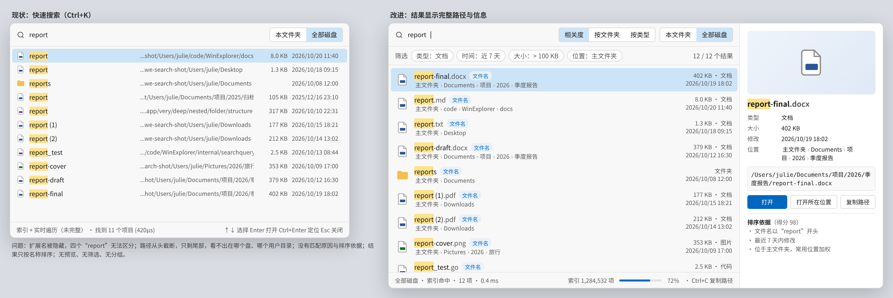
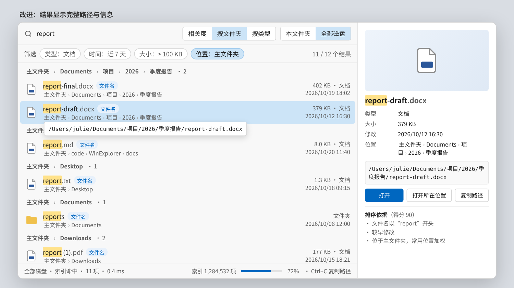

# 01 全局搜索显示增强

目标：Ctrl+K 快速搜索（以及窗格内搜索的“位置”列）显示**可区分、可定位**的结果：完整文件名、相对搜索根的完整父路径、类型/大小/时间、匹配原因、按相关度排序，并提供筛选、分组、预览。

设计稿：
- 
- 
- 交互演示：`/workspace/winexplorer-demo/search/index.html`（`?mode=shot` 为静态状态）
- 现状离屏截图：`/workspace/winexplorer-demo/search/current/01..05*.png`

## 现状（bf9ae80）

| 环节 | 位置 |
| --- | --- |
| 发起搜索、索引优先、实时遍历补足 | `searchbox.go:(*App).searchBoxFrame` → `searchindex.go:searchIndexQuery`、`search.go:streamMatches`/`walkRoot` |
| 全局根 | `search.go:globalSearchRoots`（`sysVolumes`） |
| 合并、去重、排序（只按名称） | `searchbox.go:(*searchBoxState).addHits`、`sortHitsByName` |
| 结果行 | `searchbox.go:(*App).searchHitRow`：16px 图标、`searchNameText`（`files.go`）、`tailRunes(e.Dir, 42)`、大小（仅文件）、`formatModTime`、位置按钮 |
| 空/进度 | `searchbox.go:searchBoxNotice`、`searchBoxStatus`、`searchIndexSourceNote`、`formatElapsed` |
| 窗格搜索 | `search.go:(*App).updateSearch`；位置列 `files_details.go:searchLocation`（只取 `filepath.Base(e.Dir)`）；状态栏 `search.go:searchStatusLabel` |
| 查询语言 | `internal/searchquery`：`Parse`、`Query.Matches(name, path, ext, isDir)`、`Query.Highlight(name) []Span` |

问题：
1. `a.displayName(e)` 隐藏扩展名，同名不同类型（report.docx / report.md / report.txt）显示成同一行文字。
2. `tailRunes` 从头截断，丢掉盘符与主文件夹，长路径看不出位置；窗格“位置”列只有末级目录名。
3. 排序只按名称，没有相关度；不显示为什么命中（名称 / 路径）。
4. 无完整路径提示、无预览、无筛选、无分组；文件夹不显示大小；索引构建进度不可见。

## 通用约定

- 颜色：选中 `colorSelected()`，悬停 `colorHover()`，次要文字 `colorMuted()`，强调 `colorAccent()`，分隔线 `colorDivider()`，命中高亮沿用 `searchHitSpans` 的 `tokHit`。不写死色值。
- 字号：名称 12，路径与元信息 11，分组标题 11（粗体）。
- 文字统一简体中文，不用 emoji。
- 新的纯函数（路径分段、打分）放在可单测的位置；第 3 阶段起打分逻辑放 `internal/searchquery`。

---

## 阶段 1：完整文件名 + 相对路径 + 两行行高（约 1 天）

**目标**：每条结果显示完整文件名（扩展名用 `colorMuted()`），第二行显示父路径分段。

**改动**
- `searchbox.go`
  - 新增 `const searchHitRowH float32 = 44`，`searchHitRow` 改为两行：左 24px 图标（`a.fileIcon(c, e, 24)`），中间纵向两行，右侧元信息列宽 150、右对齐（第一行 `大小 · 类型`，文件夹显示 `文件夹`；第二行 `formatModTime`）。保留位置按钮（18×18）。
  - 名称：`searchNameText(c, b.parsed, e.Name, 12)`（用 `e.Name` 而非 `displayName`），扩展名部分改由新函数 `searchNameSpans(q searchquery.Query, name string, isDir bool, font float32) []ui.Span` 生成，扩展名 span 使用 `colorMuted()`。
  - 删除 `tailRunes` 在结果行的使用（函数保留到无引用后删除）。
  - 行整体 `Tooltip(e.Path)`。
- 新文件 `searchpath.go`（package main）：
  ```go
  // pathSeg is one breadcrumb of a hit's folder: its label and the folder it opens.
  type pathSeg struct{ Label, Path string; Elided bool }
  // searchPathSegments splits dir for display: home becomes 主文件夹, a volume
  // root its volume name, and more than maxSegs segments keep the first two and
  // the last two with one elided segment between.
  func searchPathSegments(dir, home string, maxSegs int) []pathSeg
  func searchPathText(segs []pathSeg) string // "主文件夹 › Documents › … › 季度报告"
  ```
  主文件夹取 `os.UserHomeDir()`，启动时缓存；Windows 下大小写不敏感比较；分隔符显示为 ` › `（`colorMuted()`）。
- `files_details.go:searchLocation`：改为 `searchPathText(searchPathSegments(rel, home, 4))`，其中 `rel` 是相对当前搜索根（`t.path`）的父路径，等于搜索根时显示 `.` 的中文 `当前文件夹`。

**边界**：根目录文件（`/`、`C:\`）、主文件夹本身、UNC 路径（`\\server\share` 作为一个段）、非 UTF-8 名称、名称很长时第一行单行省略号截断（`SingleLine()` + `MinWidth(0)`）。

**验收**：现状截图中的 4 个 “report” 能区分为 `.docx/.md/.txt/.pdf`；`Library/Caches/.../structure` 显示为 `主文件夹 › Library › … › folder › structure`。

**测试**：`searchpath_test.go` 表驱动覆盖上述边界；`searchbox_test.go` 断言 `tt.HasText("report.md")` 与路径文本存在；窗格搜索的位置列断言为相对路径。

## 阶段 2：路径分段可点击（约 0.5 天）

**目标**：第二行每个分段是按钮，点击后关闭面板并 `a.navigate(seg.Path)`；省略段不可点击，悬停显示被省略的完整片段。

**改动**：`searchbox.go` 新增 `func (a *App) searchPathRow(c *ui.Context, e Entry)`，每段 `ui.ButtonBase(c.Key("seg-"+e.Path+"|"+seg.Path))`，悬停时文字 `colorAccent()` 加下划线、背景 `colorHover()`、圆角 3。点击分段**不**改变光标、不打开结果（内层元素先消费点击，同位置按钮的做法）。

**验收/测试**：Tester 点击某段后 `a.cur().path == seg.Path` 且 `a.searchBox.open == false`。

## 阶段 3：相关度排序（约 1.5 天）

**目标**：默认按相关度排序，可切回名称排序。

**改动**
- `internal/searchquery`：
  ```go
  type MatchKind int
  const ( MatchNone MatchKind = iota; MatchName; MatchPath )
  type Reason struct{ Text string; Weight int } // Text 为中文说明
  // Score ranks a hit: higher is better. now is passed in so tests are stable.
  func (q Query) Score(name, path string, isDir bool, mod, now time.Time) (int, MatchKind, []Reason)
  ```
  建议权重：名称完全相等 +60；名称以词开头 +40；名称包含 +25；仅路径命中 +5；7 天内修改 +10，30 天内 +5；路径含 `/Library/Caches`、`AppData`、`node_modules`、`.git`、`$Recycle.Bin` 等 −20；路径层级每深一层 −1（上限 −10）；主文件夹内 +5（主文件夹由调用方传入或作为参数，避免包内调用 `os`——推荐给 `Score` 增加 `home string` 参数）。
- `searchbox.go`：`searchBoxState` 增加 `score map[string]int`、`kind map[string]searchquery.MatchKind`、`sortBy searchSort`（`sortRelevance`/`sortName`）。`addHits` 计算并缓存分数，`sortHitsByScore` 稳定排序（分数降序，再名称，再路径）。批次到达时光标仍保持在 `cursorPath`（现有 `cursorRow` 逻辑不变）。
- 查询行增加 `ui.Segmented(c, &sortIdx, "相关度", "名称")`。

**验收**：设计稿顺序——`report-final.docx`、`report.md`、`report.txt` 在前，缓存目录的 `report.json` 靠后。
**测试**：`searchquery_test.go` 对 `Score` 表驱动（固定 `now`）；`searchbox_test.go` 断言排序结果与切换。

## 阶段 4：匹配原因标签（约 0.5 天）

**目标**：名称右侧小标签“文件名”或“路径”。仅路径命中时，名称不高亮，第二行路径中命中的部分高亮。

**改动**：`internal/searchquery` 新增 `func (q Query) HighlightPath(path string) []Span`；`searchbox.go` 新增 `searchReasonBadge(c, kind)`：高 16、左右内边距 6、圆角 8、字号 10；“文件名”文字 `colorAccent()`，“路径”文字 `colorMuted()`，背景 `colorHover()`。“内容”暂不支持（无内容索引），不显示。

**测试**：`path:` 查询及路径命中词的结果标签为“路径”。

## 阶段 5：筛选条（约 1 天）

**目标**：查询行下方一行筛选：`类型`（全部/文件夹/文档/图片/音视频/压缩包/代码）、`时间`（不限/今天/近 7 天/近 30 天/今年）、`大小`（不限/< 100 KB/100 KB–10 MB/> 10 MB）、`位置`（全部磁盘/主文件夹/当前文件夹），右侧显示“x / y 个结果”。

**实现原则**：筛选**转为查询修饰符**合并进查询再 `Parse`，引擎（索引与遍历）只认一种查询，避免两套过滤。
- `internal/searchquery` 新增修饰符：`dm:today|7d|30d|year`（修改时间）、`size:<100kb|>10mb|100kb..10mb`、`kind:folder|doc|image|media|archive|code`；`Matches` 签名扩展为 `Matches(name, path, ext string, isDir bool, size int64, mod time.Time) bool`，调用点：`search.go:walkRoot`、`searchindex.go:searchIndexQuery`（`indexEntry` 已含大小与时间时直接用；否则只在遍历结果上生效并在标签旁注明）。
- 扩展名到类型的映射复用 `files_icon.go` 中已有的分类（若无集中映射，新增 `kindOfExt(ext string) string` 放 `internal/searchquery`）。
- `searchbox.go`：`searchBoxState` 增加 `filters searchFilters`；新函数 `searchFilterBar(c)`，每个筛选是一个下拉 chip（高 22、圆角 11、边框 `colorFieldBorder()`），激活时背景 `colorSelected()`。“位置：当前文件夹”等价于现有 `scopeFolder`。
- 计数 “x / y”：y 为未筛选结果数（保留一份未筛选列表，筛选只在已有结果上重算，切换筛选不重新遍历——除非位置变化）。

**边界**：用户手写的修饰符与 chip 冲突时以 chip 为准，并在 chip 上显示；索引中缺少大小/时间的条目视为不满足大小/时间筛选。
**测试**：`searchquery_test.go` 覆盖新修饰符解析与匹配；UI 测试点击 chip 后结果数变化。

## 阶段 6：分组切换（约 0.5 天）

**目标**：`相关度 / 按文件夹 / 按类型` 三态（与阶段 3 的排序切换合并为一个 Segmented：`相关度`、`按文件夹`、`按类型`、`名称`）。分组标题行高 24，字号 11 粗体 `colorMuted()`，显示路径分段（或类型名）和“· n”。

**改动**：`searchbox.go` 新增 `type searchRow struct{ header string; hit int }` 与 `func (b *searchBoxState) rows() []searchRow`；`ui.List` 改为遍历 rows（标题行不可选中，`searchBoxMove` 跳过标题）。组内按分数排序，组之间按组内最高分排序。

**测试**：分组后标题数量与组内条目数正确；↑↓ 跳过标题。

## 阶段 7：右侧预览（约 1–1.5 天）

**目标**：面板加宽，右侧 270px 显示所选结果：缩略图（高 120，图片走 `thumb.go` 缩略图，其他用 56px 大图标）、名称（14 粗体，高亮）、类型/大小/修改/位置（键值网格，键列宽 56）、完整路径（等宽 11 号，背景用 `tokSurface`（`theme.go` 目前没有访问函数，新增 `func colorSurface() ui.Color { return tokSurface }`），可选中复制）、按钮 `打开`（主按钮）/`打开所在位置`/`复制路径`、“排序依据（得分 n）”列出 `Reason.Text`。

**改动**：`searchbox.go` 中 `searchBoxWidth` 由 760 改为 960、`searchPanelW` 同步为 960、`searchPanelH` 480 → 560；窗口宽度不足 900 时隐藏预览（只显示列表）。新增 `func (a *App) searchPreview(c *ui.Context, e Entry)`；复制路径复用 `ops.go:doCopyAsPath` 的剪贴板写法（抽出 `copyPathText(path string)`）。新增快捷键 `Ctrl+C`（查询框无选中文本时）复制所选结果路径，在 `searchBoxKeys` 中处理。

**测试**：选中第 2 条后预览显示其完整路径；点击“复制路径”后剪贴板内容等于 `e.Path`（用现有剪贴板测试的替身）。

## 阶段 8：页脚索引进度（约 0.5 天）

**目标**：页脚显示 `全部磁盘 · 索引命中 · 12 项 · 0.4 ms`，索引构建中时右侧显示 `索引 1,284,532 项` + 80×4 进度条（`colorAccent()` 填充）+ 百分比；无法估计总数时显示不定进度（来回滑动）。

**改动**：`searchindex.go` 的 `searchIndexStatus` 已有 `total`、`building`、`progress`（来自 `searchIndex.progress`，构建中已收集的条目数）。只需增加 `estimate int`（上一次完整构建的 `total`，保存在索引文件里；首次构建为 0 → 不定进度），由 `searchIndexState` 填写；`searchbox.go:searchBoxStatus` 用 `progress/estimate` 画进度条。数字用千分位格式（新增 `groupThousands(n int) string`）。

**测试**：`searchindex_test.go` 中构建过程中 `progress` 递增且 `estimate` 取上次 `total`；`groupThousands` 表驱动。

---

## 总验收

- 离屏截图与设计稿两张 PNG 一致（布局、文字、颜色 token），附在 PR。
- 原 `searchbox_test.go`、`search_stream_test.go`、`searchindex_test.go`、`searchmark_test.go` 全部通过（行高变化需更新 `TestCtrlKSearchBox` 中“约一行间距 20–40”的断言为 40–50）。
- 1 万条结果下列表滚动不卡顿：`rows()` 与分数缓存只在结果/筛选变化时重算，不在每帧重算。
